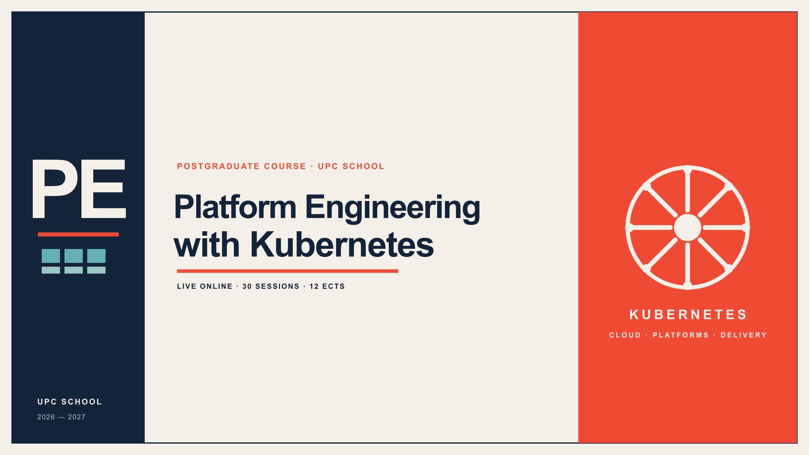
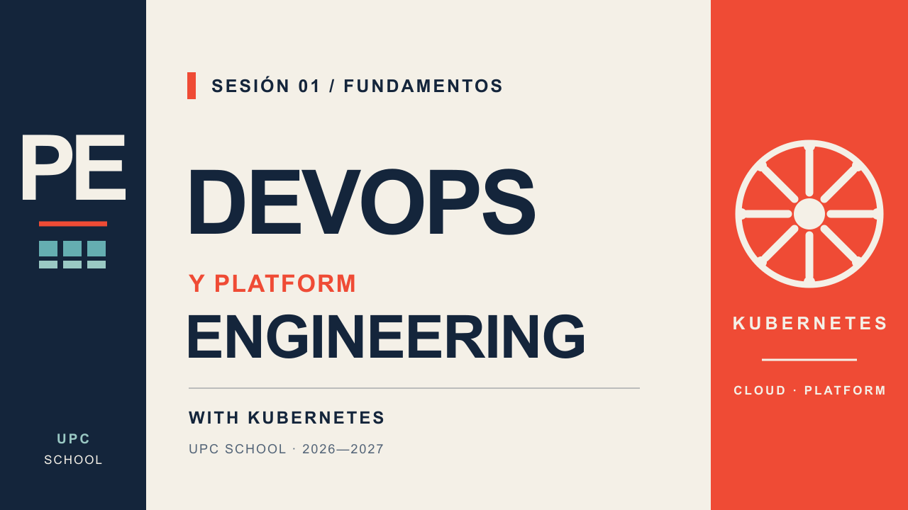
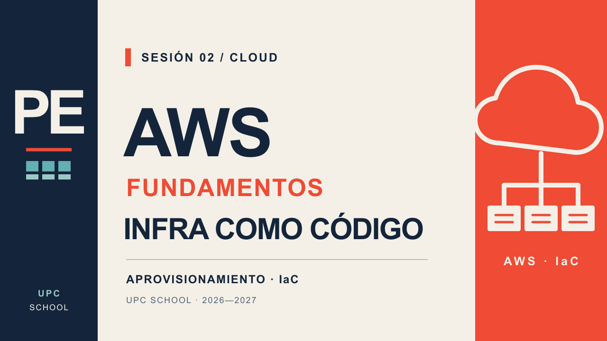
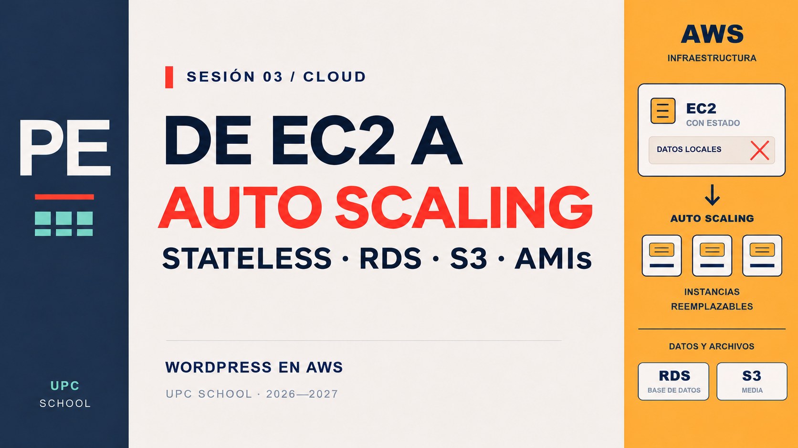

# Posgrado en Platform Engineering y DevOps con Kubernetes

## Edición 2026–2027

UPC School · Live online · Castellano · 12 ECTS.

30 sesiones de 3 horas, martes y jueves de 18:00 a 21:00 (Europe/Madrid). Inicio 03/11/2026; última clase de contenido 11/03/2027; presentación y defensa del Trabajo Final 18/03/2027 con René Serral y Rael Garcia, incluida en las 90h. El desarrollo del proyecto es trabajo autónomo; el 16/03 no hay clase.

- [Syllabus resumido](syllabus-resumido.md): estructura, docentes y sesiones.
- [Syllabus detallado](syllabus-detallado.md): objetivos, contenidos, prácticas y ampliaciones.
- [Calendario](calendario.md): clases, docentes y días sin clase.
- [Calendario CSV](calendario.csv): sesiones para importar en una hoja de cálculo.
- [Guía docente interna](guia-docente-interna.md): cobertura mínima, concentración y alcance de prácticas para el equipo docente.
- [Datos del curso](curso.json): contenidos, fechas y docentes estructurados.
- [Laboratorios de infraestructura](https://github.com/raelga/kubernetes-talks/tree/main/course/infra): Terraform, EC2 y la evolución de WordPress por etapas.
- [Introducción a Terraform: S3 y estado remoto](https://github.com/raelga/kubernetes-talks/tree/main/course/infra/labs/terraform-intro): ejercicio independiente de buckets, cambios, drift y migración del estado.

M1 integra 9h de contenido, incluidas en las 90h: 3h propias y 6h transversales en Contenedores II, AWS, Azure/GCP, Tekton y operators. Sus 1,5 ECTS incluyen trabajo autónomo evaluable.

El código y las instrucciones de los laboratorios se mantienen únicamente en `raelga/kubernetes-talks/course/`; este repositorio conserva la planificación y los enlaces, sin copias locales de los ejercicios. El laboratorio introductorio de Terraform es material de preparación, no una sesión adicional ni una ampliación automática de las 90h.

## Sesiones en vídeo

| Sesión 1 · Fundamentos | Sesión 2 · AWS e infraestructura como código | Sesión 3 · De EC2 a Auto Scaling |
| --- | --- | --- |
|  |  |  |
